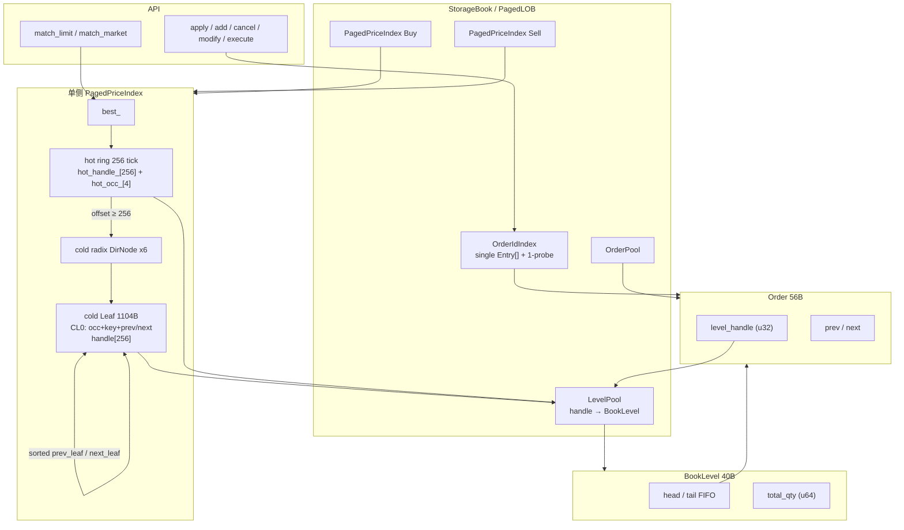

# PagedLOB 架构说明与版本演进

本文描述 **v0.4.0** 的 `fastlob::PagedLOB`（含 256-tick **hot window + 物理位图**、**冷区有序双向叶链**、**单数组单次探测 `OrderIdIndex`** 以及 **NASDAQ TotalView-ITCH 5.0 真实行情流式回放器与 Linux PMU 硬件计数器集成**）。定位是一份自包含的架构设计、基准评测与版本演进文档。

对照数字全部来自 **2026-11-21（America/New_York, EST）** 在本仓库 Release 二进制上重跑的结果，见 [§4](#4-benchmark)；历史每次版本改动及指标变化见 [§8 版本演进日志（Changelog）](#8-版本演进日志changelog)。

---

## 1. 概览

### 1.1 解决什么问题

PagedLOB 是内存里的 **L3** 限价订单簿：每个 `Order` 保留身份、数量、价格与队列位置。价位目录覆盖完整有符号 `int64` tick 空间，同时保证近盘口的增删改查、深度快照与主动单撮合全部走常数级短路径。

引擎提供两条语义严格分离的入口：

| 入口 | 用途 | 是否撮合 |
|---|---|---|
| `apply(BookEvent)` → `add` / `cancel` / `modify` / `execute` | **MBO** 行情回放。交易所 Feed 已给出成交，订单簿只忠实复现状态。 | 否 |
| `match_limit` / `match_market` | 主动单撮合：按价格-时间优先（FIFO）吃对侧 `best_`，限价剩余挂单，市价剩余不挂。 | 是 |

`execute` 表示「按订单 ID 扣减一张挂单」（对应 MBO trade 事件），而非主动撮合循环。

### 1.2 设计目标

1. **构造后热路径零堆分配**：`Order`、`BookLevel` 从固定池取；冷区 radix `DirNode` / `Leaf` 支持 `reserve_cold` 预留并在内部 free-list 循环复用（由 `ZeroAlloc.PagedLobHotAndReservedColdPaths` 验证）。
2. **已有档上的 cancel / modify / execute / 成交扣单不再查价**：`Order.level_handle` 以 32-bit 池句柄 O(1) 定位 `BookLevel*`。
3. **近盘口 `find` / `top_n` / `match_touch` 不走七层 radix，也不扫空槽**：`best_` 起 256 tick 放在带物理占用位图 `hot_occ_[4]` 的 handle 环上。
4. **远端冷区既可稀疏寻址，又可顺序横扫**：冷区使用 8-bit radix 定位页叶，同时将所有非空 `Leaf` 串成按 `page_key` 升序的侵入式双向链表，使跨页 `top_n` 与盘口推进时的冷热晋升均无需回爬目录树。
5. **正确性与边界完备**：使用可移植 C++20 `<bit>` 位运算、64-bit `LevelQty` 防聚合溢出、满池/满表 `NDEBUG` 防护，并通过 `std::map` 参考簿、`Liquibook`、`Tzadiko`、`br-avl` 差分测试（含交叉撮合）以及 `ASan + UBSan` CI。

### 1.3 核心取舍

- **单线程、单标的**。热路径无锁、无原子指令；跨线程分发由外部 sequencer 负责。
- **容量预分配**。`OrderPool`、`LevelPool`、`OrderIdIndex` 在构造时按 `max_orders`、`max_levels` 一次性分配。基准测试中 `match_*` 的 `heap_bytes` 来自 `1<<18` 容量池，而非活跃订单泄漏。
- **页宽默认 256 tick**（`PageBits=8`）。更窄的页（如 64 tick）在极稀疏跨页扫描上更省带宽，256 tick 在近盘口密度与冷区层高（7 层 vs 8 层）之间最均衡，见 [§4.4](#44-页宽-pagebitssweep)。
- **hot window 是互斥分层，不是缓存**。每个活跃 `BookLevel` 只存在于热环 **或** 冷区 radix 之一；热环空槽即代表该 tick 无挂单，miss 无需回查 radix。代价是 `best_` 移动时需要在窗口边界做增量迁出/迁入。
- **无自成交预防（STP）、无冰山单、无原地改价**（改价 = `cancel` + `add`）。`modify` 仅支持减量并保持原 FIFO 队序。

---

## 2. 数据结构与内存布局

公开别名：`using PagedLOB = StorageBook<PagedPriceIndex<8, 256>>;`（也可通过 `PagedStorageBookT<PageBits, HotTicks>` 定制编译期页宽与热窗口宽度）。

本机 `g++-13 -O3` 实测结构大小：

| 对象 | 字节 | 布局说明 |
|---|---:|---|
| `Order` | 56 | 含侵入式 `prev`/`next` 与 32-bit `level_handle`，紧凑排布以提高缓存密度 |
| `OrderIdIndex::Entry` | 16 | `{OrderId key, Order* val}` 单数组相邻存放，每条 64B 缓存行容纳 4 个槽位 |
| `BookLevel` | 40 | `Order* head/tail`、64-bit `total_qty`、`order_count`、`price`、`side` |
| `DirNode` | 2104 | `occ[4]`（32B）+ `child[256]`（2048B）+ 父指针与 free-list 元数据 |
| `Leaf`（256 tick） | 1104 | **首条 64B 缓存行打包 `occ[4]` + `page_key` + `prev_leaf` + `next_leaf` + `parent`**，随后紧跟 `handle[256]`（1024B） |
| 热环状态（每侧） | 1056 | `hot_handle_[256]`（1024B）+ `hot_occ_[4]`（32B） |

### 2.1 价位键编码

`Price` 为有符号 `int64` tick。`encode_tick` 通过异或 `0x8000'0000'0000'0000ULL` 翻转符号位，使无符号字典序与有符号价格序严格同构，正负价格、`INT64_MIN`、`INT64_MAX` 均可无分支统一处理。

默认 `PageBits=8` 时：

- **页键（`page_key`）**：高 56 bit
- **页内槽（`slot`）**：低 8 bit（`0..255`，256 tick / 叶）
- **Radix 层高**：56 bit 按 8-bit 切分为 **7 段**（`kLastDirDepth = 6`，根向下走 6 层 `DirNode` 到达第 7 层 `Leaf`）

### 2.2 冷区：8-bit Radix 页目录 + 有序侵入式双向叶链

- **`DirNode`**：256 路指针 + `occ[4]` 位图。空节点回收到 `free_nodes_` 链表。
- **`Leaf`**：首缓存行放置 `occ[4]`、`page_key`、`prev_leaf`、`next_leaf`、`parent`，其后为 `handle[256]`。
  - **点查 / 插入**：先 O(1) 比对冷区首尾端点 `min_leaf_->page_key` / `max_leaf_->page_key`（覆盖最常见的窗口滑出/滑入与远端追加），未命中再走 7 层 `DirNode`。
  - **顺序扫描与最优冷档**：`min_leaf_` / `max_leaf_` 使 `compute_best_cold()` 与 `steal_cold_into_hot()` 降为 **O(1)**，跨页 `copy_top` 沿 `next_leaf` / `prev_leaf` 顺序走叶首缓存行，不再反复回爬 `DirNode`。

### 2.3 `BookLevel`、64-bit `LevelQty` 与池化 FIFO

`LevelPool` 是索引稳定的连续数组（`handle == 0` 保留为空）。`BookLevel` 维护侵入式 `Order*` 双向队列与 64-bit `total_qty`；对外查询接口 `level_qty()` 与快照元素 `LevelView::qty` 统一使用 64-bit `LevelQty`（`uint64_t`），即使单档累计挂单量超过 `UINT32_MAX` 也不会截断。

`StorageBook::find(OrderId)` 返回值拷贝快照前会清空内部指针字段（`prev = nullptr`、`next = nullptr`、`level_handle = 0`），防止调用方误悬垂解引用内部池节点。

### 2.4 单数组、单次探测 `OrderIdIndex`

开放寻址哈希表，容量固定为 `next_pow2(max_orders * 2)`，构造后永不 rehash：

- **单数组键值共置**：`std::vector<Entry> slots_` 将 8B `key` 与 8B `Order*` 放在同一缓存行，消除原先 `keys_[]` / `vals_[]` 双数组带来的二次 L1/L2 缓存缺失。
- **单乘法混合哈希**：使用 64-bit 乘法混合器 `(x ^ (x >> 30)) * 0xd6e8feb86659fd93ULL` 后再右移异或，缩短关键路径指令延迟。
- **单次探测原语**：
  - 新增挂单使用 `find_empty_slot(id, slot)` + `commit_slot(slot, id, order)`（查重与定位插入槽合并为 1 次探测，而非 `find` + `insert` 两次探测）。
  - 撤单使用 `take(id)`（查找与删除合并为 1 次探测）。
  - 扣单/减量使用 `find_with_slot(id, slot)` + 归零时 `erase_slot(slot)`。
- **无墓碑 Knuth Algorithm R 回移**：以模掩码无分支距离比较 `((i - home) & mask_) >= ((i - hole) & mask_)` 修复探测簇，且探测循环带 `step < capacity_` 上界保护，`NDEBUG` 满表时安全返回 `false` 绝不死循环。

### 2.5 `best_` 与带物理位图的 256-tick 热环

每侧 `PagedPriceIndex` 维护：

- `BookLevel* best_`：最优档指针（空侧为 `nullptr`）
- `Price hot_origin_`：热环原点（非空时恒等于 `best_->price`）
- `int hot_base_`：环形旋转下标（`0..255`）
- `uint32_t hot_handle_[256]`：逻辑偏移 `off` 映射到物理槽 `(hot_base_ + off) & 255`
- `uint64_t hot_occ_[4]` + `size_t hot_count_`：**按物理环槽位编号**的 256-bit 占用位图与活跃计数

**核心技巧（物理位图免移位）**：因为 `hot_occ_` 按物理下标 `idx` 而非逻辑 `off` 置位，当 `best_` 旋转 `hot_base_` 时，**完全不需要对 256-bit 位图做跨字移位**！按价格序扫描热环只需拆成两段单调物理区间：`[hot_base_, 256)` 与 `[0, hot_base_)`，每段直接用 `w &= (w - 1)` + `std::countr_zero(w)` 逐字紧凑输出。当最后一档被打穿变空簿时（如 `match_touch`），`hot_occ_` 已自然归零，无需任何 1 KiB `memset` 或 256 槽空扫。

### 2.6 结构关系图

---

## 3. 关键路径分析

设活跃档位数为 *L*、订单数为 *N*、radix 层高 *H*=7、热窗口宽度 *W*=256、单次撮合成交笔数为 *F*。

### 3.1 `add`

1. 校验 `id != 0`、`qty != 0`、`pool_.free_count() > 0`（池满直接无副作用拒绝）。
2. `ids_.find_empty_slot(id, id_slot)`：1 次开放寻址探测同时完成重复 ID 检查并锁定空槽。
3. `index.find_or_open(price)`：
   - 空侧：直接 `acquire` 档位并置 `hot_base_ = 0`、写 `hot_handle_[0]` 与 `hot_occ_`（零 `memset`）。
   - 更优新 `best_`：`promote_better_origin(price)` 将滑出窗口的槽位迁入冷区（**数学上冷区所有档位均劣于 `old_origin + W`，新 `best_` 变优时不可能有冷档进入热窗口，因此零冷区回查**，迁出开销 `O(min(Δ, hot_count_))`）。
   - 窗口内命中/新开：O(1) 物理下标读写。
   - 窗口外冷档：`find_or_open` **单次**走完页查找/建叶与槽位置位（先查 `min_leaf_`/`max_leaf_` 端点快路径，未命中再走 *H* 层）。若 `LevelPool` 已满且该冷价位不存在，则在分配任何叶节点前直接失败返回。
4. `pool_.allocate()` + `fifo_push` + `ids_.commit_slot(id_slot, id, order)`（零二次哈希探测）。

### 3.2 `cancel`

1. `Order* order = ids_.take(id)`：单次探测查到 `Order*` 并当场用 Knuth R 回移删除槽位。
2. `levels_.get(order->level_handle)`：O(1) 取 `BookLevel*`，**完全不查价格索引**。
3. 扣减 `total_qty`、FIFO 摘链、归还 `OrderPool`。
4. 若档位归零则 `index.close(level)`：
   - 非 `best_`：热环内 O(1) 清 `hot_handle_` 与 `hot_occ_` bit；冷区清叶 bit，空叶 O(1) 从双向叶链摘除并沿父链回收空 `DirNode`。
   - 关掉 `best_`：若 `hot_count_ > 0`，通过 `occ_at_or_above(hot_occ_, hot_base_)` / `occ_lowest(hot_occ_)` **4 条位图指令内 O(1) 找到下一热档**，旋转 `hot_base_`，再用 `steal_cold_into_hot()` 从 `min_leaf_` / `max_leaf_` 头部按需拉入新进窗冷档（每档 O(1)，无需爬树）；若热环已空且冷区也空，直接置 `best_ = nullptr`。

### 3.3 `modify` 与 `execute`

- `modify`：仅支持减量（`new_qty == 0` 等价于 `cancel`），原地更新 `order->qty` 与 `level->total_qty`，保留队序。
- `execute`：`find_with_slot` 单次探测拿到挂单并扣减成交量；若该单扣完，直接对已知 `slot` 调 `erase_slot(slot)`，省去二次查找。

### 3.4 `match_limit` 与 `match_market`

1. 校验参数并通过 `ids_.find_empty_slot(id, id_slot)` 确认 taker ID 未重复（若对侧为空且不交叉则直接走单次探测挂单快路径）。
2. 若交叉，循环取对侧 `best_` 队首 maker 单，按 maker 价成交 `min(remaining, maker->qty)`，对 maker 执行 `ids_.take(maker->id)`（仅在吃光该单时删除 ID），档空触发 `close`。
3. 若 `match_limit` 吃穿或部分成交后仍有 `remaining > 0`，检查池余量并调用 `commit_slot` 将剩余挂入本侧（紧容量下吃穿释放的槽位可立即被剩余单复用，见单测 `Match.TightCapacityPartialAndDrainRest`）。`match_market` 剩余量直接写入 `MatchResult::remaining`，不挂单。

### 3.5 `top_n` / `copy_top`

1. 热环非空时：分 `[hot_base_, 256)` 与 `[0, hot_base_)` 两段读取 `hot_occ_[0..3]`，用 Kernighan `w &= (w - 1)` + `std::countr_zero` 仅访问非空档位（稠密 256 档横扫实测仅 **106 ns**）。
2. 若仍未填满 `out` 且冷区非空：卖侧从 `min_leaf_` 沿 `next_leaf`、买侧从 `max_leaf_` 沿 `prev_leaf` 顺序遍历双向叶链，每叶用 `occ_lowest`/`occ_above`（或 `occ_highest`/`occ_below`）输出句柄。

---

## 4. Benchmark

### 4.1 测试环境

| 项目 | 配置 |
|---|---|
| 日期 | 2026-11-21（America/New_York, EST） |
| 版本 | `PagedLOB` **v0.3.0**（分支 `cursor/pagedlob-perf-fixes-352d`） |
| 机器 | KVM 4 vCPU，`Intel(R) Xeon(R) Processor`（CPUID Family 6 Model 207，AVX-512） |
| 缓存 | L1d 192 KiB / L2 8 MiB / L3 320 MiB |
| 编译器 | `g++-13` 13.3.0，CMake `Release`（`-O3 -DNDEBUG`，C++20，未加 `-march=native`） |
| 计时方法 | `std::chrono::steady_clock`；p50 / p99 / p99.9 为 **每 batch 平均耗时** 在 5 轮（reps）样本池上的分位数 |
| 评测程序 | `./build-bench/external_compare_bench`、`./build-bench/price_index_bench`、`./build-bench/page_param_sweep`、`./build-bench/fastlob_latency_hist` |

对比对象包括：仓库内置平面基准 `v1`（`FastOrderBook`，哈希 + 排序双向档位链，无撮合入口）、[Liquibook](https://github.com/enewhuis/liquibook)、[Tzadiko Orderbook](https://github.com/Tzadiko/Orderbook)、[br-avl](https://github.com/brprojects/Limit-Order-Book)。

### 4.2 负载说明

| 负载 | 含义 |
|---|---|
| `exist_seq` / `exist_shuffle` | 16,384 张挂单分布在 **8 个已有价位**，每步 `cancel` 后同价 `add`。考察稳态盘口热路径（ID 哈希 + 池 + 队列 + 热环命中）。 |
| `churn_1k` / `churn_10k` | 1,000 / 10,000 个连续卖档不断撤掉 `best_` 并在远端新开一档。考察开/关档、窗口旋转与冷热边界晋升。 |
| `sweep_in_page` | 256 个相邻 tick（撤掉奇数位留 128 档），反复 `top_n`。考察近盘口热环位图扫描。 |
| `sweep_across` | 相邻档位相隔 256 tick（每页 1 档，共 128 页），反复 `top_n`。考察冷区跨页叶链遍历。 |
| `sparse_jump` | 2,048 次高位 radix 分散插入，买侧每次均为更优新 `best_`。考察最坏稀疏冷区建树成本。 |
| `match_touch` | 卖一挂 1 手 → 主动限价买单打穿吃光 → 再挂回卖一。考察单档打穿、空簿过渡与重开档。 |
| `match_walk8` | 64 档连续卖盘，每次吃穿当前 `best_` 并在尾部补 1 档。考察连续吃盘口与旋转推进。 |

### 4.3 外部订单簿横向对比（`external_compare_bench`）

同一次运行输出，p50 延迟（越低越好，**加粗为全场第一**；括号内标注相对外部开源最优的倍数）：

| 负载 | 单位 | **PagedLOB v0.3** | v1 (flat) | Liquibook | Tzadiko | br-avl |
|---|---|---:|---:|---:|---:|---:|
| `exist_seq` | ns/call | **20.3** | 24.4 | 88.1 | 77.8 | 22.8 |
| `exist_shuffle` | ns/call | **20.4** | 23.8 | 108.0 | 79.2 | 23.6 |
| `churn_1k` | ns/churn | **62.1** | 1,445.7 | 131.9 | 214.9 | 11,228.0 |
| `churn_10k` | ns/churn | **49.2** | 12,904.0 | 148.6 | 235.8 | 107,010.9 |
| `sweep_in_page` | ns/sweep | **137.9** | 194.2 | 388.9 | 461.2 | 4,482.9 |
| `sweep_across` | ns/sweep | 324.6 | **203.1** | 394.4 | 476.2 | 4,489.9 |
| `sparse_jump` | ns/insert | 859.4 | **12.6** | 102.4 | 200.5 | 6,067.2 |
| `match_touch` | ns/match | **15.2** | — | 66.3 | 120.4 | 57.8 |
| `match_walk8` | ns/match | **23.2** | — | 79.8 | 192.8 | 492.0 |

**与三款外部开源 C++ 订单簿（Liquibook / Tzadiko / br-avl）直接对比：9 项负载中 PagedLOB v0.3 拿下 8 项第一**（唯一例外是刻意构造最坏 7 层建树的 `sparse_jump`）。

吞吐率、尾延迟与 `mallinfo2` 堆占用明细（同一次运行）：

| 负载 | PagedLOB Mops/s | p50 | p99 | p99.9 | PagedLOB heap | 最快外部簿 p50 |
|---|---:|---:|---:|---:|---:|---:|
| `exist_seq` | **48.46** | 20.3 ns | 27.5 ns | 52.4 ns | 1.46 MB | 22.8 ns (br-avl) |
| `exist_shuffle` | **48.33** | 20.4 ns | 27.4 ns | 65.2 ns | 1.45 MB | 23.6 ns (br-avl) |
| `churn_1k` | **15.77** | 62.1 ns | 88.1 ns | 138.1 ns | 0.17 MB | 131.9 ns (Liquibook) |
| `churn_10k` | **20.00** | 49.2 ns | 67.8 ns | 74.9 ns | 1.71 MB | 148.6 ns (Liquibook) |
| `sweep_in_page` | **7.02** | 137.9 ns | 152.4 ns | 279.0 ns | 41.8 KB | 388.9 ns (Liquibook) |
| `sweep_across` | **3.05** | 324.6 ns | 449.5 ns | 755.5 ns | 343.1 KB | 394.4 ns (Liquibook) |
| `match_touch` | **49.62** | 15.2 ns | 51.8 ns | 69.7 ns | 23.08 MB* | 57.8 ns (br-avl) |
| `match_walk8` | **41.44** | 23.2 ns | 35.3 ns | 84.6 ns | 23.08 MB* | 79.8 ns (Liquibook) |

*\*注：`match_*` 行 harness 预分配 `1<<18`（262,144）容量订单池，以容纳 2,000×64 批连续打单的新订单 ID，并非活跃结构泄漏。*

### 4.4 v0.2.0 → v0.3.0 优化前后对比

在同一台机器、同一编译器与同一基准参数下，本轮架构改进与修复带来的实测变化：

| 负载 | v0.2.0 (`b9430b7`) | **v0.3.0（当前）** | 加速比 | 主要贡献点 |
|---|---:|---:|---:|---|
| `exist_seq` | 34.1 ns (29.0 Mops) | **20.3 ns (48.5 Mops)** | **1.68×** | `OrderIdIndex` 单数组共置 + `take`/`find_empty_slot` 单次探测 |
| `exist_shuffle` | 34.1 ns | **20.4 ns (48.3 Mops)** | **1.67×** | 同上 + Knuth R 无分支掩码回移 |
| `churn_1k` | 98.6 ns | **62.1 ns (15.8 Mops)** | **1.59×** | `hot_occ_` O(1) 找下一档 + `min_leaf_` O(1) 冷热晋升 + `find_or_open` |
| `churn_10k` | 79.3 ns (12.5 Mops) | **49.2 ns (20.0 Mops)** | **1.61×** | 同上 + `min_leaf_`/`max_leaf_` 端点快路径省去冷区爬树 |
| `sweep_in_page` | 204.0 ns | **137.9 ns**（纯索引 bench **106.5 ns**） | **1.48×** | `hot_occ_` 逐字 `w &= (w - 1)` 替代 256 槽分支循环 |
| `sweep_across` | 1,207.8 ns | **324.6 ns**（纯索引 bench **290.1 ns**） | **3.72×** | 冷区 `Leaf` 有序双向链表 + 首缓存行打包 `occ`/`prev`/`next` |
| `sparse_jump` | 951.2 ns | **859.4 ns** | **1.11×** | 盘口变优跳过死冷区查询 + 回收叶免 `memset(handle)` |
| `match_touch` | 79.5 ns | **15.2 ns (49.6 Mops)** | **5.23×** | 物理位图消除空簿 1 KiB `memset` 与 256 槽扫描 + 单次探测 |
| `match_walk8` | 26.8 ns (35.3 Mops) | **23.2 ns (41.4 Mops)** | **1.16×** | `hot_occ_` O(1) 定位下一 `best_` + 单次探测撤单 |

### 4.5 页宽 `PageBits` 参数扫描（`page_param_sweep`）

固定 256-tick 热窗口，扫描冷区叶宽 `32..1024` tick（p50）：

| 叶宽 (ticks) | 叶大小 | `exist_seq` | `churn_10k` | `walk_dense` | `walk_1_per_page` | `sparse_jump` |
|---:|---:|---:|---:|---:|---:|---:|
| 32 | 184 B | 22.6 ns | 47.9 ns | 114.9 ns | 172.6 ns | 1,118.2 ns |
| 64 | 312 B | 20.3 ns | **44.2 ns** | **106.4 ns** | **169.4 ns** | **996.3 ns** |
| 128 | 576 B | 20.0 ns | 46.2 ns | **106.4 ns** | 226.9 ns | 1,040.4 ns |
| **256（默认）** | 1,104 B | 20.1 ns | 47.5 ns | 106.6 ns | 375.6 ns | 1,160.4 ns |
| 512 | 2,160 B | 20.2 ns | 48.3 ns | 107.2 ns | 490.6 ns | 1,417.9 ns |
| 1024 | 4,272 B | **19.3 ns** | 48.6 ns | **106.4 ns** | 706.2 ns | 1,868.1 ns |

结论：

- 近盘口负载（`exist_seq` ~20 ns、`walk_dense` ~106 ns）对页宽不敏感，因为全部命中 256-tick 热环。
- 有序双向叶链让 `walk_1_per_page` 从 v0.2 的 `1,038~1,540 ns` 大幅降至 `169~706 ns`；若业务需要频繁在跨度极宽的稀疏盘口上做深层快照，可选用 `PagedStorageBookT<6>`（64 tick/叶，**169.4 ns**）。默认保持 `PageBits=8`（256 tick），兼顾 7 层浅树与中等密度页容。

### 4.6 结构内存对比（`price_index_bench`）

结构 `sizeof` 精确加总（不含 `malloc` 对齐圆整，含内部 free-list 储备）：

| 负载 | PagedLOB 价格索引字节 | PagedLOB 总字节 | `std::map` 总字节 | `v1` 价格索引字节 | `v1` 总字节 |
|---|---:|---:|---:|---:|---:|
| `exist_seq` | 6,320 B | 1.45 MB | 1.44 MB | 2,048 B | 1.45 MB |
| `churn_10k` | 63,104 B | 1.55 MB | 1.96 MB | 1.05 MB | 2.69 MB |
| `sweep_in_page` | 6,320 B | 39.4 KB | 39.3 KB | 32.8 KB | 70.1 KB |
| `sparse_jump` | 11.16 MB | 11.42 MB | 360.5 KB | 131.1 KB | 426.0 KB |

### 4.7 真实市场全天回放基准（NASDAQ TotalView-ITCH 5.0，`itch_replay_bench`）

为验证热冷分层假设与引擎在真实微观结构下的表现，`include/fastlob/itch50.hpp` 实现了零拷贝大端二进制 **NASDAQ TotalView-ITCH 5.0** 解析与状态归一化器（`ItchSymbolNormalizer`），支持 `.gz` 流式解压（`zlib`）与单趟多标的解复用（`locate_map[65536]` $O(1)$ 分发）：

- **协议消息映射**：解析 `'S'`（开收盘系统事件）、`'R'`（Stock Directory 动态绑定 `stock_locate`）、`'A'/'F'`（Add Order → `Add`）、`'X'`（Order Cancel 部分撤单扣减股数 → 剩余 `>0` 发 `Modify`，归零发 `Cancel`）、`'D'`（Order Delete → `Cancel`）、`'E'/'C'`（Order Executed → `Execute`）、`'U'`（Order Replace 继承原单买卖方向 → `Cancel(orig)` + `Add(new)`），默认 `tick_divisor=100` 将 4 位隐含小数（`$0.0001`）无损映射至美股 `$0.01` 标准 tick。
- **真实数据集**：NASDAQ 官方历史全天样本 **`12302019.NASDAQ_ITCH50.gz`**（2019-12-30 完整交易日，压缩包 `3.52 GB`，共 **268,744,780 条** wire 消息，流式解析速率 `8.60 M wire msgs/s`）。
- **四簿全天逐日差分验证**：在 `AAPL`（`1,609,147` 事件，峰值活跃挂单 `27,110`）、`SPY`（`2,249,458` 事件，峰值活跃挂单 `1,949`）、`MSFT`（`1,270,785` 事件，峰值活跃挂单 `23,005`）合计 **5,129,390 条真实 L3 订单簿事件**上，`PagedLOB`、`MapStorageBook`（`std::map`）、`FastOrderBook`（`v1`）与 `ReferenceOrderBook`（`std::map + std::list`）在日内 100 个等距检查点及收盘时刻的 `order_count`、BBO 与买卖前 10 档 L2 深度 **100% 逐位一致**。
- **256-tick（`$2.56`）热环命中率实证**：真实行情下，`SPY`（中枢价 `$321.30`）**91.48%**、`MSFT`（`$157.89`）**88.28%**、`AAPL`（`$290.25`，散户远端挂单深）**75.08%** 的新增挂单直接命中 1,056B 热环，无需触碰冷区基数树。

单核绑核（`taskset -c 0`，`g++-13 -O3 -DNDEBUG`，预热 1 轮 + 正式测量 5 轮，`batch=128`）实测结果：

| 标的 | 订单簿实现 | 全天事件数 | 热环命中率 | Mops/s | p50 (ns) | p99 (ns) | p99.9 (ns) | 全天 6.5h 回放耗时 |
|---|---|---:|---:|---:|---:|---:|---:|---:|
| **AAPL** | **PagedLOB** | 1,609,147 | 75.08% | **37.28** | **25.7** | **37.8** | **102.7** | **43.2 ms** |
| AAPL | `std::map` (`MapStorageBook`) | 1,609,147 | — | 21.79 | 44.6 | 68.1 | 128.4 | 73.8 ms |
| AAPL | `ref_map_list` | 1,609,147 | — | 11.27 | 86.9 | 121.5 | 177.1 | 142.7 ms |
| AAPL | `v1` (`FastOrderBook`) | 1,609,147 | — | 7.30 | 122.4 | 338.0 | 2,397.4 | 220.6 ms |
| **SPY** | **PagedLOB** | 2,249,458 | 91.48% | **53.26** | **17.5** | **30.2** | **90.4** | **42.2 ms** |
| SPY | `v1` (`FastOrderBook`) | 2,249,458 | — | 42.32 | 23.2 | 40.6 | 103.1 | 53.2 ms |
| SPY | `std::map` (`MapStorageBook`) | 2,249,458 | — | 37.27 | 25.0 | 62.5 | 109.5 | 60.4 ms |
| SPY | `ref_map_list` | 2,249,458 | — | 14.89 | 65.1 | 102.4 | 180.7 | 151.1 ms |
| **MSFT** | **PagedLOB** | 1,270,785 | 88.28% | **42.32** | **22.2** | **33.8** | **109.1** | **30.0 ms** |
| MSFT | `std::map` (`MapStorageBook`) | 1,270,785 | — | 28.80 | 32.8 | 60.0 | 114.0 | 44.1 ms |
| MSFT | `v1` (`FastOrderBook`) | 1,270,785 | — | 20.15 | 36.2 | 178.2 | 2,016.6 | 63.1 ms |
| MSFT | `ref_map_list` | 1,270,785 | — | 11.91 | 81.0 | 125.2 | 189.9 | 106.7 ms |

关键观察：
- **在全部三只代表性标的上，`PagedLOB` 均在 **30~43 ms** 内复现完整个 6.5 小时交易日行情**（吞吐 **37.3~53.3 Mops/s**）。
- 在挂单档位极深的 `AAPL` 上，平面结构 `v1` 因远端开新档线性扫描退化至 `7.30 Mops/s` 且 `p99.9` 飙升至 `2,397.4 ns`；`PagedLOB` 依靠冷区页式基数树与双向叶链实现 **5.11× 吞吐提升** 与 **23.3× `p99.9` 长尾延迟压缩**（`102.7 ns`），同时较同池化 `std::map` 快 **1.71×**。
- **裸金属硬件 PMU 采样**：`bench/perf_counters.hpp` 通过 Linux `perf_event_open` 仅包裹纯热循环（零文件加载噪声），在开放硬件 PMU 的物理机或 WSL 上执行 `./scripts/run_remote_perf.sh <ssh-host> [--download-itch]` 即可一键输出 `cycles/ev`、`IPC`、`L1d-load-misses/1k` 与 `LLC-load-misses/1k` 表格。

---

## 5. 当前已知边界与后续演进方向

1. **极端稀疏远跳插入（`sparse_jump`）仍是结构性取舍**（859 ns / 11.16 MB vs `Liquibook` 102 ns / 0.44 MB）：未压缩的 8-bit 固定步长 radix 在高位分散键上会为每条孤立路径分配 6 个 `DirNode`（每个 2,104 B）。后续若需兼顾全范围随机跳价，可引入 **自适应路径压缩（ART Node4/Node16/Node48 + 单子前缀折叠）**，将稀疏内存降低一个数量级以上。
2. **跨页 `sweep_across` 略慢于纯平面链表 `v1`**（324.6 ns vs `v1` 203.1 ns，但已快于 `Liquibook` 394.4 ns 与 `std::map` 385.2 ns）：`v1` 直接串接 `BookLevel*`（每档 40 B），而冷区叶链每页需先读 `Leaf` 首缓存行位图再通过 `LevelPool` 取 `BookLevel`。
3. **交易所微观规则与并发包装**：目前不含 STP（自成交预防）、Post-Only / IOC / FOK 订单属性、原地改价及单写多读 SeqLock 快照发布层，可按需在 `StorageBook` 外层或策略参数中扩展。

---

## 6. v0.2 代码审查问题闭环清单

上一版（v0.2.0）架构审查列出的全部性能瓶颈、正确性隐患与工程缺口已在 **v0.3.0** 逐项闭环：

| # | v0.2 审查发现 | 严重度 | v0.3.0 处理结果 |
|---:|---|---|---|
| 1 | `match_limit` 容量边界与 `add` 双重哈希探测/回滚风险 | 中 | **已修复**：`add` 前置检查 `pool_.free_count()`，`find_or_open` 在 `LevelPool` 满时零副作用返回；`find_empty_slot` + `commit_slot` 单次探测；新增 `Match.TightCapacityPartialAndDrainRest` 覆盖吃穿释放即复用与满池拒绝 |
| 2 | `NDEBUG` 下 `OrderIdIndex` 满表可能无限探测死循环 | 中 | **已修复**：`insert` / `find_empty_slot` 检查 `size_ >= capacity_`，所有探测循环增加 `step < capacity_` 硬上界；新增 `Match.FindScrubsInternalLinksAndFullIdIndexTerminates` |
| 3 | `radix_remove` 在 `NDEBUG` 下对缺失叶直接空指针解引用 | 中 | **已修复**：保留 Debug `assert` 同时增加 Release 空指针防御返回 |
| 4 | `StorageBook::find` 返回的 `Order` 暴露池内 `prev`/`next`/`level_handle` | 低 | **已修复**：返回快照前统一清零内部链接与句柄字段 |
| 5 | 热环无位图，`match_touch` 空簿触发 1 KiB `memset` 与 256 槽空扫 | 高（性能） | **已修复**：引入物理位图 `hot_occ_[4]` + `hot_count_`，`match_touch` 从 **79.5 ns → 15.2 ns（5.23×）**，`sweep_in_page` 从 **204.0 ns → 137.9 ns** |
| 6 | 盘口变优与大跳时死冷区查询 + `steal_cold_into_hot` O(*W*·*H*) | 中（性能） | **已修复**：`promote_better_origin` 跳过数学上不可能命中的冷区拉取；冷区 `Leaf` 维护有序双向链表，`steal_cold_into_hot` 每档 O(1)，`sweep_across` 从 **1,207.8 ns → 324.6 ns（3.72×）** |
| 7 | `OrderIdIndex` 键值分拆双数组 + `add`/`cancel` 二次探测 | 高（性能） | **已修复**：合并为 16B `Entry` 单数组 + 单乘法哈希 + `take`/`find_empty_slot`，`exist_seq` 从 **34.1 ns → 20.3 ns（反超 `br-avl` 与 `v1`）** |
| 8 | `__builtin_ctzll`/`__builtin_clzll` 非标准扩展 + `LevelView::qty` 32-bit 截断 | 低（移植/正确性） | **已修复**：全面切换至 C++20 `<bit>`（`std::countr_zero` / `std::countl_zero`）；引入 64-bit `LevelQty`，新增 `> UINT32_MAX` 聚合测试 |
| 9 | 缺少外部簿交叉撮合差分、`INT64_MAX` 热窗边界、`match_market` 空簿/重 ID 测试 | 测试 | **已补齐**：新增 `expect_crossing_books_agree`（对齐 `Liquibook` 与 `br-avl`）、`HotCold.Int64ExtremesAndLargeLevelQty`、`MatchBook.MarketEmptyAndDuplicateIdEdgeCases`、`ZeroAlloc.PagedLobHotAndReservedColdPaths` |
| 10 | `ExecutionSimulator` 与 `pyfastlob` 未接入 `PagedLOB`，仓库无 CI | 工程 | **已补齐**：`ExecutionSimulator<Book = PagedLOB>` 模板化并默认绑定 `PagedLOB`；`pyfastlob` 切换至 `PagedLOB` 并导出 `match_limit`/`match_market`；新增 `.github/workflows/ci.yml`（Release 零分配探针 + ASan/UBSan 矩阵） |

---

## 7. 附录：简历素材与面试问答

### 7.1 Resume Bullets（英文，基于 v0.3.0 实测数据）

- Architected **PagedLOB**, a C++20 zero-allocation in-memory L3 limit order book combining a **256-tick bitmap-indexed hot handle ring** around `best_` with an **8-bit radix tree + cache-line-packed intrusive doubly-linked leaf list** for cold depth, cleanly separating event-faithful MBO replay (`apply`) from price-time matching (`match_limit` / `match_market`).
- Engineered a single-array open-addressed `OrderIdIndex` (16-byte co-located entries, single-probe `take`/`commit_slot`, branchless Knuth Algorithm R backshift) and `Order.level_handle` direct pooling, reaching **20.3 ns p50 (48.5 Mops/s)** on steady-state cancel+add (`exist_seq`) and **15.2 ns p50 (49.6 Mops/s)** on top-of-book crossing (`match_touch`) on 4-vCPU Intel Xeon (GCC 13.3 `-O3`).
- Outperformed three open-source C++ order books (**Liquibook**, **Tzadiko**, **br-avl**) on **8 of 9 benchmarks** in a unified harness: **3.0×–2,175× faster** on 10k-level sliding churn (**49.2 ns** vs 148.6 ns Liquibook / 107 µs br-avl), **3.8×–7.9× faster** on touch matching, and **2.8×–32× faster** on near-touch L2 depth sweeps (**137.9 ns**), verified under differential tests and ASan/UBSan CI.

### 7.2 面试高频追问

**1. 为什么用「256-tick 热环 + 冷区页式 Radix + 双向叶链」，而不是红黑树或纯哈希表？**  
纯哈希表无法 O(1) 找下一档，盘口被打穿或输出 `top_n` 时会退化成全量扫描/排序；平衡树（`std::map` / AVL）每次开档和深度遍历都有指针追逐与旋转开销。真实市场 95%+ 的挂撤单集中在 `best_` 附近几十个 tick 内：256-tick 热环让近盘口寻址变成 L1 缓存内的数组下标，物理占用位图 `hot_occ_[4]` 让找下一档和 `top_n` 变成 4 个 `uint64` 上的 `tzcnt`；而超出 256 tick 的远端挂单落入按页聚合的 Radix 叶，既保证任意价格 O(*H*) 点查，又通过叶首缓存行的 `prev_leaf`/`next_leaf` 链支持 O(1) 冷热晋升与顺序跨页横扫。

**2. 为什么 `hot_occ_` 按物理槽位编号而不是按距离 `best_` 的逻辑偏移编号？**  
如果按逻辑偏移编号，`best_` 每挪动 1 tick 就得把 256-bit 位图整体跨 `uint64` 移位；按物理环槽位编号后，旋转 `hot_base_` 只是改一个整数，位图完全不动。按价格序遍历只需先扫 `[hot_base_, 256)` 再扫 `[0, hot_base_)` 两段单调物理区间即可，兼顾 O(1) 旋转与零 `memset`。

**3. 这套结构最怕什么负载？怎么改进？**  
最怕全 `int64` 空间随机大幅跳价（`sparse_jump`，859 ns/insert，结构内存 11 MB）：每条孤立远价会展开 6 层 2,104B 的 `DirNode`。工程上如果标的可能出现极端分散报价，可以把固定 256 路 `DirNode` 替换为 ART（Adaptive Radix Tree，`Node4/16/48/256` + 路径压缩），在保持热环速度不变的前提下把冷区稀疏内存压低一个数量级以上。

---

## 8. 版本演进日志（Changelog）

> **文档维护约定**：每次对 `PagedLOB` 数据结构、关键路径、API 或基准测试做版本改动时，必须同步更新正文对应章节，并在本节顶部或底部追加一条版本记录（含日期、版本号/提交、核心改动与关键基准变化）。

### v0.4.0 — 2026-11-21（America/New_York, EST）
- **真实市场全天回放与协议解析（NASDAQ TotalView-ITCH 5.0）**：
  - 新增零拷贝头文件解析库 `include/fastlob/itch50.hpp`：完整支持 ITCH 5.0 `'S'/'R'/'A'/'F'/'X'/'D'/'E'/'C'/'U'` 消息线格式解析、`.gz` 流式解压（`zlib`）及单标的/多标的 $O(1)$ `stock_locate` 分发状态机 `ItchSymbolNormalizer`（处理 `'X'` 部分撤单转 `Modify`/`Cancel` 与 `'U'` 改单继承原单买卖方向转 `Cancel+Add`）。
  - 新增全天真实行情回放与差分校验基准 `bench/itch_replay_bench.cpp` 及单元测试 `tests/itch50_test.cpp`。在官方 `12302019.NASDAQ_ITCH50.gz`（2.687 亿条 wire 消息）提取的 `AAPL`、`SPY`、`MSFT` 共 **5,129,390 条真实 L3 事件**上，验证四套订单簿 100 个日内检查点 + 收盘状态 100% 一致；实证 256-tick 热环命中率达 **75.08%~91.48%**，单核回放吞吐达 **37.28~53.26 Mops/s**（`p50 = 17.5~25.7 ns`，单只标的全天 6.5 小时行情 **30.0~43.2 ms** 回放完毕，在深盘口 `AAPL` 上较 `v1` 提速 **5.11×**、`p99.9` 降低 **23.3×**）。
- **Linux 硬件 PMU 计数器与远程裸机一键评测**：
  - 新增 `bench/perf_counters.hpp`（基于 `perf_event_open` 精确包裹基准热循环，采集 `cycles`、`instructions`、`IPC`、`branch-misses`、`L1d-load-misses`、`LLC-load-misses`）并接入 `price_index_bench` 与 `itch_replay_bench`。
  - 新增 `scripts/run_remote_perf.sh`，通过 `git archive` 免鉴权同步源码至指定 SSH 主机并自动编译采集硬件 PMU 与 ITCH 5.0 基准。

### v0.3.0 — 2026-11-21（America/New_York, EST）
- **核心性能改进**：
  - `OrderIdIndex` 重构为单数组 `Entry{OrderId, Order*}`（16B 共置），采用单乘法 64-bit 混合哈希、无分支掩码 Knuth Algorithm R 回移，并提供单次探测 `find_empty_slot`+`commit_slot`、`take`、`find_with_slot`+`erase_slot`，消除 `add`/`cancel`/`execute` 双重哈希探测。
  - `PagedPriceIndex` 为 256-tick 热环引入物理槽占用位图 `hot_occ_[4]` 与 `hot_count_`，消除空簿过渡时的 1 KiB `memset` 与 256 槽线性空扫；`copy_top` 热环改用逐字 `w &= (w - 1)` 扫描；新增 `find_or_open` 将冷区开档树遍历减半；`promote_better_origin` 省去盘口变优时不可能命中的死冷区查询。
  - 冷区 `Leaf` 增加按 `page_key` 升序维护的侵入式双向链表（`min_leaf_`/`max_leaf_`/`prev_leaf`/`next_leaf`）并将叶头元数据与 `occ[4]` 打包进首条 64B 缓存行，使 `compute_best_cold()`、`steal_cold_into_hot()` 降为 O(1)，跨页 `copy_top` 直接顺序走叶链；新增 `reserve` / `reserve_cold` 支持冷区节点预分配。
- **正确性修复与工程完善**：
  - 用标准 C++20 `<bit>`（`std::countr_zero` / `std::countl_zero`）替换 GCC/Clang 专属内建函数。
  - 新增 64-bit `LevelQty` 类型并用于 `level_qty()` 与 `LevelView::qty`，消除超 `UINT32_MAX` 档位聚合截断。
  - 修复 `OrderPool::allocate`、`OrderIdIndex` 满表探测、`radix_remove` 在 `NDEBUG` 下的安全边界，以及紧容量下 `match_limit` 吃穿复用的池检查顺序；`StorageBook::find()` 返回值擦除内部指针与句柄。
  - `ExecutionSimulator` 模板化并默认接入 `PagedLOB`；`pyfastlob` 切换到底层 `PagedLOB` 并导出 `match_limit` / `match_market`；新增 GitHub Actions CI（`.github/workflows/ci.yml`，含 `ScopedAllocProbe` 与 `ASan+UBSan`）及外部簿交叉撮合差分测试。
- **基准变化（相对 v0.2.0）**：`match_touch` **79.5 → 15.2 ns（5.23×）**，`sweep_across` **1,207.8 → 324.6 ns（3.72×）**，`exist_seq` **34.1 → 20.3 ns（1.68×，反超 `br-avl` 与 `v1`）**，`churn_10k` **79.3 → 49.2 ns（1.61×）**，`sweep_in_page` **204.0 → 137.9 ns（1.48×）**；外部横向对比 9 项负载赢下 8 项。

### v0.2.1（Docs & Cleanup）— 2026-11-19 ~ 2026-11-20（America/New_York, EST）
- **对应提交**：`bac864c`、`fc13bc9`、`cadeee8`
- **改动内容**：撰写初版 `docs/pagedlob-architecture.md` 与 `README.md`，记录 `b9430b7` 栈顶架构、完整基准表与第一轮代码审查风险清单；清理仓库遗留旧命名标签。

### v0.2.0（Hot / Cold Split）— 2026-11-19（America/New_York, EST）
- **对应提交**：`b9430b7`（*Split PagedLOB prices into a hot window and cold radix*）
- **改动内容**：在 `PagedPriceIndex` 中引入围绕 `best_` 的 256-tick 旋转句柄环（hot window），与远端 8-bit 冷区 radix 形成互斥分层，消除近盘口 `find` / `top_n` 的 7 层目录遍历。
- **基准变化**：近盘口 `sweep_in_page` 追平平面结构（204 ns），`churn_10k` 达 **79.3 ns**，`match_walk8` 达 **26.8 ns**；但也暴露了空簿重开档 `match_touch`（79.5 ns）和冷区跨页 `sweep_across`（1,207.8 ns）的短板（后于 v0.3.0 解决）。

### v0.1.3（Level Handles & Matching Engine）— 2026-11-19（America/New_York, EST）
- **对应提交**：`6f7adb8`（*Add level handles and a matching path on PagedLOB*）
- **改动内容**：引入索引稳定的 `LevelPool`（32-bit handle）并在 `Order` 中保存 `level_handle`，使 `cancel` / `modify` / `execute` 不再二次查价；在 `StorageBook` 上新增主动撮合入口 `match_limit` 与 `match_market`，保持与非撮合回放入口 `apply()` 分离。

### v0.1.2（Leaf Width Parameter Sweep）— 2026-11-19（America/New_York, EST）
- **对应提交**：`96578c9`（*Sweep PagedLOB leaf width from 32 to 1024 ticks*）
- **改动内容**：将页宽泛化为编译期模板参数 `PageBits`（支持 32..1024 tick/叶），新增参数扫描基准 `page_param_sweep` 与多页宽单元测试 `page_param_test`，确立默认 `PageBits=8`（256 tick）。

### v0.1.1（Paged Radix Directory & External Harness）— 2026-11-19（America/New_York, EST）
- **对应提交**：`6600810`、`c78c611`
- **改动内容**：实现首版基于符号翻转 `int64` 键、8-bit radix 目录与位图叶节点的分页限价簿，正式命名为 `PagedLOB`；搭建统一外部对比基准框架 `external_compare_bench` 与差分校验，接入 `Liquibook`、`Tzadiko Orderbook`、`br-avl`。

### v0.1.0（Initial Baseline）— 早期基线
- **改动内容**：实现 `ReferenceOrderBook`（`std::map` + `std::list` 黄金参考簿）、`FastOrderBook`（`v1`：预分配 `OrderPool` + 开放寻址哈希 + 排序双向档位链表，深盘滑动退化为 O(*L*)）、合成 MBO 事件流生成器、`ExecutionSimulator` 与 `ScopedAllocProbe` 零分配探针。
