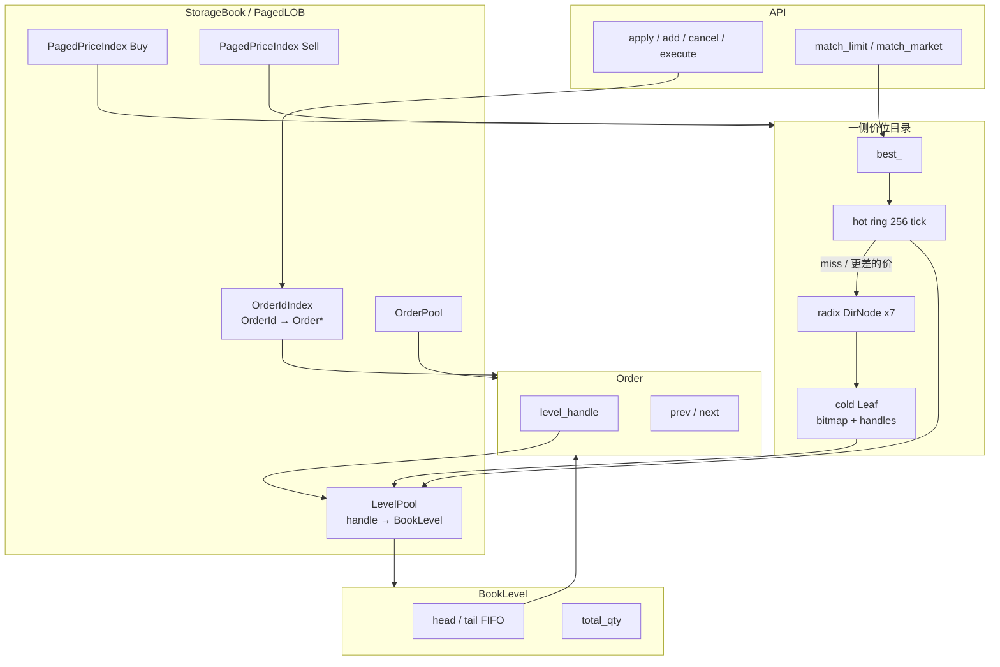

# PagedLOB 架构说明

本文描述 **当前栈顶** 的 `fastlob::PagedLOB`（commit `b9430b7`，含 256-tick **hot window**）。对象是一份可放进简历包的设计说明，不是 API 手册。

对照数字全部来自 2026-11-19（America/New_York）在本仓库 Release 二进制上重跑的结果，见 [§4](#4-benchmark)。正文只讨论 PagedLOB；其它 book 只出现在基准表里。

---

## 1. 概览

### 1.1 解决什么问题

PagedLOB 是内存里的 **L3** 限价簿：每个 `Order` 保留身份、数量、价格、队列位置。价位目录覆盖整个 `int64` tick 空间，但近盘口的更新和扫描必须走短路径。

两条互不混淆的入口：

| 入口 | 用途 | 是否撮合 |
|---|---|---|
| `apply(BookEvent)` → `add` / `cancel` / `modify` / `execute` | 合成 **MBO** 回放。Feed 已经给出成交，簿只复现状态。 | 否 |
| `match_limit` / `match_market` | 主动单：吃对侧 `best_` 的 FIFO，限价剩余挂上，市价剩余不挂。 | 是 |

`execute` 是「按 id 扣一张休息单」，给 MBO 的 trade 事件用，不是撮合循环。

### 1.2 设计目标

1. **构造后热路径零堆分配**：`Order`、`BookLevel`、radix 节点都从池或 free-list 取。
2. **已有档上的 cancel / execute 不再查价**：`Order.level_handle` 直接拿到 `BookLevel*`。
3. **近盘口 `find` / `top_n` 不走七层 radix**：best 起 256 tick 放在 handle 环上。
4. **稀疏、远离盘口的价仍要有序、可回收**：冷区是 occupancy bitmap 的页叶 + 8-bit radix。
5. **正确性可差分**：同一串 `apply` 事件与 `std::map` 金标准和 typed 撮合测试对齐。

### 1.3 取舍

- **单线程**。没有锁、没有 seqlock。并发是调用方的事。
- **容量预留**。`OrderPool` / `LevelPool` / `OrderIdIndex` 在构造时按 `max_orders`、`max_levels` 一次分配。撮合 bench 里 `heap_bytes` 很大，是池子，不是 live 订单。
- **页宽默认 256 tick**（`PageBits=8`）。更窄的叶对跨页扫描略好，对 exist/churn 几乎无差；见 [§4.4](#44-页宽-pagebitssweep)。
- **hot window 是互斥分层，不是 cache**。窗口内的档不进 radix；空槽就表示这个 tick 没有档。因此 `find` 在窗口内是数组下标，但 best 移动时必须把越过边界的档搬进/搬出 radix。
- **没有 STP、没有隐藏单、没有价格修改**（改价 = cancel+add）。`modify` 只允许数量下调并保留 FIFO 位置。
- **Python / Execution Simulator 还没接到 PagedLOB 上。**

---

## 2. 数据结构与内存布局

公开类型：`using PagedLOB = StorageBook<PagedPriceIndex<8>>;`（第二模板参数默认 `HotTicks=256`）。

本机 `g++-13 -O3` 测到的 `sizeof`：

| 对象 | 字节 |
|---|---:|
| `Order` | 56（上限 64，不 `alignas(64)`，优先密度） |
| `BookLevel` | 40 |
| `DirNode` | 2104 |
| `Leaf`（256 tick） | 1080 |

### 2.1 价位键

`Price` 是 `int64` tick。`encode_tick` 翻转符号位，使无符号顺序与价格顺序一致，于是 radix 和页槽对负价、`INT64_MIN` 都成立。

默认 `PageBits=8`：

- 页键 = 高 56 bit
- 页内槽 = 低 8 bit → **256 tick / 叶**
- 8-bit 一截 → **7 个 digit**，最后一截指向 `Leaf`（`kLastDirDepth = 6`，从 root 走 6 个 `DirNode` 再进叶，共 7 步）

### 2.2 Radix 页目录（冷区）

`DirNode`：256 个 child 指针 + 4×`uint64` occupancy。空节点回收到 `free_nodes_`，不还给 OS。

`Leaf`：`occ[4]`（256 bit）+ `handle[256]`（32-bit `LevelPool` 句柄）。遍历用 `__builtin_ctzll` / `__builtin_clzll` 找下一个占用槽，不扫空 tick。

冷区 **只存放窗口以外的档**。近盘口 256 tick 不占叶。

### 2.3 `BookLevel` 与池化 FIFO

`LevelPool` 是下标稳定的 slab，**handle 0 为空**。`BookLevel` 上是 `Order*` 侵入式双向 FIFO（`head` / `tail`）和 64-bit `total_qty`（档位合计，避免 32-bit 环绕）。

`Order` 上是 `prev` / `next`、数量、以及 `level_handle`。Cancel / execute / 撮合扣单用 handle 取档，**不再 `find(price)`**。

### 2.4 `OrderIdIndex`

开放寻址、容量固定为 `next_pow2(max_orders * 2)`，构造后不 rehash。`erase` 清槽后再 `rehash_from` 把簇补回去（没有 tombstone）。热路径每次 cancel 都要做一次哈希探测，这是 exist 负载里仍然贵的部分之一。

### 2.5 `best_` 与 hot window

每侧一个 `PagedPriceIndex`，各自持有：

- `BookLevel* best_`：当前最优档（买最高 / 卖最低）
- `Price hot_origin_`：窗口原点，等于 `best_->price`（有档时）
- `int hot_base_`：环的旋转量
- `uint32_t hot_handle_[256]`：offset `i` 对应 `hot_handle_[(hot_base_ + i) & 255]`，卖侧价格 `origin+i`，买侧 `origin-i`

best 挪 1 tick：`hot_base_` ±1，近端槽迁出到 radix，远端槽从 radix 偷入。跳跃（`|Δ| ≥ 256`）走 `rebuild_hot`。

### 2.6 结构关系

---

## 3. 关键路径

复杂度按「一次调用、档位数 *L*、订单数 *N*、radix 高度 *H*=7、窗口 *W*=256」写。单线程，cache 行为是经验，不是证明。

### 3.1 `add`

1. 拒绝 `id==0`、`qty==0`、重复 id。
2. `index.find(price)`：在窗口内 O(1) 下标；否则 O(*H*) 走 radix。
3. 未命中则 `open`：`LevelPool::acquire`，新 best 则 `rebase`，窗口内写环，否则 `radix_put`。
4. `OrderPool::allocate`，写字段和 `level_handle`，`fifo_push`（档位 `total_qty += qty`），`OrderIdIndex::insert`。

已有档、价在窗口内：不碰 radix，叶也不动。新档且是更优价：可能旋转或重建整个窗口。订单池空且刚 `open` 成功会 `close` 回滚（有单测）。

### 3.2 `cancel` / `remove_order`

1. `OrderIdIndex::find`（开放寻址）。
2. `levels_.get(order->level_handle)`，**不查价**。
3. 减 `total_qty`，FIFO unlink，erase id，还订单槽。
4. 档空则 `index.close`：窗口内清环槽；冷档 `radix_remove`，叶空则回收目录。

若关掉的是 `best_`：`next_best` 先扫环（通常 offset 1 就是下一个），再 `rebase`。稠密盘口上 best 挪 1 tick 是 O(1) 旋转 + 一次远端 `radix_find`。

### 3.3 `modify`

只允许 `new_qty ≤ old`。0 等于 cancel。否则只改该单 `qty` 和档位 `total_qty`，**不改变 FIFO 位置**。

### 3.4 `execute`

按 id 找到休息单，`apply_fill`。部分成交留在队头；数量归零则 unlink，档空则 `close`。这是 MBO 的成交事件，不是撮合。

### 3.5 `match_limit`

对侧 `best_`，限价能交叉则吃 FIFO 头：`take = min(remaining, head->qty)`，成交价是 **maker 价**，然后 `apply_fill`（走 `level_handle`）。循环直到数量没了、对侧空了、或不再交叉。剩余走自己的 `add`。

复杂度大约 O(*F* + 被打穿的档位数)。打穿 best 会 `close`+`rebase`。`fills` 向量可选，传入才会分配。

### 3.6 `match_market`

与限价相同，但交叉条件恒真（买用 `Price::max`，卖用 `Price::min` 当 cap）。剩余 **不挂**。

### 3.7 best / 下一价

有档时 `best_` 就是窗口 offset 0。`copy_top` 按 offset 0…255 扫环（跳过 0 句柄），不够再从冷区 leftmost/rightmost 叶用 ctz 走。近盘口 `top_n` 主要是环上的顺序扫描，不碰目录。跨页、远离 best 的深度仍是「叶链 + 每叶 bitmap」。

### 3.8 开档 / 关档 / 热冷升降级

| 事件 | 热 | 冷 |
|---|---|---|
| 第一档 | 原点 = 该价，写 `hot[0]` | 不动 |
| 窗口内新档 | 写下标 | 不动 |
| 窗口外更差的新档 | 不动 | `ensure_leaf` + bitmap set |
| 新的更优价，Δ&lt;256 | 环转向更优一侧，远端 tick 迁出到 radix | 近端空槽可从 radix 偷回 |
| 新的更优价，Δ≥256 | `rebuild_hot`：旧环按价格重放，再 `steal_cold_into_hot` | 旧窗口里更差的档全部在 radix |
| 关掉非 best | 清该槽或 `radix_remove` | 叶空则回收 |
| 关掉 best | 清槽，选下一档，旋转使它到 offset 0 | 新窗口远端从 radix 补 |

升降级 **不** `acquire`/`release` `BookLevel`，只改索引。对象地址和 handle 保持稳定，所以已挂在上面的 `Order.level_handle` 仍然有效。

Cache 直觉：exist / 近盘口 match 打在 `Order` 池、`OrderIdIndex`、256 个 handle 的环（1 KiB）上。Cold `open` 沿 7 个 2104 字节的 `DirNode` 走，稀疏跳价会连续 miss。叶 1080 字节，一页内的 ctz 扫描比跨很多 `DirNode` 便宜。

---

## 4. Benchmark

### 4.1 环境

| 项 | 值 |
|---|---|
| 日期 | 2026-11-19，America/New_York |
| 代码 | `cursor/hot-cold-levels-352d` @ `b9430b7` |
| 机器 | KVM，4 vCPU；`/proc/cpuinfo` `model name: Intel(R) Xeon(R) Processor`；CPUID Family 6 Model 207；AVX-512 |
| 缓存（lscpu） | L1d 192 KiB / L2 8 MiB / L3 320 MiB（虚拟化，L3 按 host 切片报） |
| 编译 | `g++-13` 13.3.0，CMake `Release`：`-O3 -DNDEBUG`，C++20，**无** `-march` |
| 计时 | `std::chrono::steady_clock`；p50/p99/p99.9 是 **每个 batch 均值** 的分位数，5 个 rep 池在一起 |
| 重复 | 默认 5 rep；exist 2000 batch × 128 ops；churn 400 × 16；sweep 500 × 8；sparse 128 × 16；match_touch 2000 × 64；match_walk8 400 × 16 |
| 二进制 | `./build-bench/external_compare_bench`、`price_index_bench`、`page_param_sweep` |

其它 book 只在本表出现：内部 baseline（表中列名 `v1`）、[Liquibook](https://github.com/enewhuis/liquibook)、[Tzadiko Orderbook](https://github.com/Tzadiko/Orderbook)、[br-avl](https://github.com/brprojects/central-limit-order-book)。PagedLOB 的 `apply`/`add` 不撮合；`match_*` 行才走撮合。Liquibook / Tzadiko / br-avl 在 `add` 里撮合，所以 match 行调用的是它们的 `add`，限价交叉。v1 没有撮合 API，match 行无数据。

`heap_bytes` 是 glibc `mallinfo2`（`uordblks + hblkhd`）在簿活着时的增量，含分配器开销。PagedLOB 的大数字主要是构造时的池，不是 live 图。`price_index_bench` 的字节列是 `sizeof` 加总，和 mallinfo **不是同一列**。

exist / churn / sweep / sparse **不交叉**（单侧或买卖不撞）。价格为正且进 `int32`，避开 0（Liquibook 把 0 当市价）。

### 4.2 每个负载测什么

| 负载 | 测什么 |
|---|---|
| `exist_seq` / `exist_shuffle` | 16384 单、**8 个已有价**。Batch 里 cancel 再以同价 add 回去。已有档热路径（id 哈希 + FIFO + 窗口 `find`）。shuffle 打乱 id 顺序。 |
| `churn_1k` / `churn_10k` | 连续卖档滑动：撤 best，在远端再挂一档。开/关档 + best 移动。 |
| `sweep_in_page` | 256 个相邻 tick，撤掉奇数档，反复 `top_n`。近盘口扫描（热环）。 |
| `sweep_across` | 价差 256 tick，扫描跨很多页。冷区叶链。 |
| `sparse_jump` | 2048 次插入，键在高位 radix digit 上分开；买侧每次都是新的 best。最坏目录分配 + 窗口重建。 |
| `match_touch` | 一档卖一拍，限价买吃掉，再补一档卖。单档打穿再 `open`。 |
| `match_walk8` | 64 档卖，每次吃 best 一拍，在当前最差价再补一档。沿 `best_` 走 FIFO。 |

### 4.3 对照表（`external_compare_bench`）

p50，单位见表头。**加粗是该行最低 p50。**

| 负载 | 单位 | PagedLOB | v1 | liquibook | tzadiko | br-avl |
|---|---|---:|---:|---:|---:|---:|
| exist_seq | ns/call | 34.1 | 37.4 | 87.9 | 77.3 | **23.3** |
| exist_shuffle | ns/call | 34.1 | 36.6 | 107.9 | 78.8 | **23.5** |
| churn_1k | ns/churn | **98.6** | 1664.8 | 134.1 | 214.0 | 11137.4 |
| churn_10k | ns/churn | **79.3** | 12894.6 | 148.1 | 232.2 | 103251.5 |
| sweep_in_page | ns/sweep | 204.0 | **201.9** | 392.8 | 457.2 | 4502.2 |
| sweep_across | ns/sweep | 1207.8 | **202.0** | 393.9 | 466.6 | 4506.3 |
| sparse_jump | ns/insert | 951.2 | **15.2** | 95.6 | 196.3 | 5906.0 |
| match_touch | ns/match | 79.5 | — | 66.3 | 113.1 | **52.8** |
| match_walk8 | ns/match | **26.8** | — | 78.5 | 181.1 | 490.1 |

Mops 与 heap（同一次 run）：

| 负载 | PagedLOB Mops | PagedLOB heap | br-avl p50 | br-avl heap |
|---|---:|---:|---:|---:|
| exist_seq | 28.98 | 1 447 392 | 23.3 ns | 1 477 024 |
| churn_10k | 12.52 | 1 705 360 | 103251.5 ns | 1 923 760 |
| match_walk8 | 35.31 | 23 077 616 | 490.1 ns | 10 528 |

match 行 PagedLOB heap 大，是因为 harness 把订单池建成 `1<<18`，不是 64 档活着需要 23 MB。

### 4.4 页宽 `PageBits` sweep

`page_param_sweep`，同一套 exist / churn / walk / sparse，叶宽 32…1024 tick。hot window 固定 256 tick。p50：

| ticks | exist_seq | churn_10k | walk_dense | walk_1_per_page | sparse_jump | 叶字节 |
|---:|---:|---:|---:|---:|---:|---:|
| 32 | 34.6 | 79.2 | 176.4 | **1038.0** | **1274.6** | 160 |
| 64 | **33.9** | 79.2 | 188.1 | 1096.8 | 1242.3 | 288 |
| 128 | 34.4 | **78.4** | 177.5 | 1086.4 | 1296.7 | 552 |
| 256（默认） | 34.1 | 79.2 | **162.0** | 1112.5 | 1407.2 | 1080 |
| 512 | 34.1 | 83.4 | 175.9 | 1150.2 | 1677.4 | 2136 |
| 1024 | 36.4 | 78.6 | 177.0 | 1540.4 | 2128.4 | 4248 |

exist / churn 几乎与页宽无关（热路径在窗口和订单池上）。稀疏和「一页一档」扫描随叶变大变慢、变占内存。默认 256 是密度和近盘口 walk 的折中，不是稀疏最优。

### 4.5 结构内存（`price_index_bench`）

`sizeof` 加总，不含 malloc 圆整。PagedLOB `price index bytes` 含目录 free-list 储备。

| 负载 | PagedLOB price bytes | PagedLOB total | v1 price bytes | v1 total |
|---|---:|---:|---:|---:|
| exist_seq | 6 256 | 1 449 368 | 2 048 | 1 445 632 |
| churn_10k | 62 080 | 1 546 408 | 1 048 576 | 2 692 864 |
| sparse_jump | 11 106 416 | 11 368 600 | 131 072 | 425 984 |

稀疏时 PagedLOB 为每条远离的 best 留一条 radix 路径，**结构字节比 v1 高两个数量级**。这和 §4.3 里 mallinfo 的 6.9 MB vs 0.46 MB 是同一现象。

同 harness 下 exist_seq p50：PagedLOB 32.4 ns，v1 32.7 ns（价格含 0，适配器更薄）。对外比请用 §4.3。

---

## 5. 已知弱点与后续方向

1. **exist 仍慢于 br-avl**（34.1 vs 23.3 ns/call）。窗口已经让 `find(price)` 变成下标；剩下的是 `OrderIdIndex` 探测、`erase` 的 `rehash_from`、以及 br 订单上的父档指针 + 更浅的价位哈希。要追 24 ns 得动 id 索引或把「最后一档」缓存在订单路径上，不是再加一层价位目录。
2. **稀疏新 best 又慢又肥**。每次插入重建或旋转窗口，并沿 7 层 `DirNode`（每个 2104 B）分配。v1 把新 best 链到链表头，§4.3 里是 15.2 vs 951.2 ns/insert。
3. **跨页 `top_n`**（`sweep_across` 1208 ns）比链表 baseline（202 ns）和 Liquibook（394 ns）慢。冷区要跳叶，热环帮不上跨度 ≫256 tick 的深度图。
4. **`match_touch` 慢于 br-avl / Liquibook**（79.5 vs 52.8 / 66.3）。打穿唯一一档等于 `close`+空簿+再 `open`，付一次窗口安装。沿 best 连吃（`match_walk8`，26.8 ns）这条路径是强项。
5. **`steal_cold_into_hot` 反复 `compute_best_cold`**。一次大跳若把很多冷档拉进窗口，会变成 O(*W*·*H*)。
6. **Python 和 Execution Simulator 仍未使用 PagedLOB。**
7. **无锁、无 STP、无改价。** 多线程和交易所语义都还没做。

---

## 6. Review 发现

通读 `paged_price_index.hpp`、`storage_book.hpp`、`level_pool.hpp`、`memory_pool.hpp`、`order.hpp`、`price_key.hpp` 和测试。**只报告，本 PR 不改代码。** 差分测试（含随机流、热冷边界、撮合）是绿的；下面不是「测试正在失败」，是读代码看到的风险和缺口。

### 中

1. **`match_limit` 部分成交后 rest 失败没有回滚。** `match_incoming` 先 `apply_fill`，再 `add` 剩余。若订单池在 rest 时耗尽：`ok==false`、`rested==false`，但 maker 侧已经扣过。调用方如果只看 `ok` 会以为没动。没有覆盖「打完再挂时池满」的测试。
2. **NDEBUG 下 `OrderIdIndex` 满表可能死循环。** `insert`/`find`/`erase` 靠空槽（`kInvalidOrderId`）结束探测。`assert(size_ < capacity_)` 在 Release 里消失。正常 `max_orders*2` 的容量让 live 订单先撞 `OrderPool`，所以这是容量约定被打破时的 Release 风险，不是当前 bench 路径。
3. **`close`/`radix_remove` 在 Release 里信任不变量。** 叶缺失时 `find_leaf` 返回空，下一句解引用。Debug 有 assert。不变量靠测试维持。

### 低

4. **`StorageBook::find` 返回 `Order` 值拷贝**，里面的 `prev`/`next` 指向池内节点。用这些指针改簿是 UAF 等待发生。应当成快照，不当成句柄。
5. **热环 `copy_top` 没有 occupancy bitmap**，最坏扫 256 个槽。`top_n(1)` 在 offset 0 有 best 时是 O(1)；窗口很空、`out` 又很大时会扫满 *W*。
6. **跳价 `rebuild_hot` + `steal_cold_into_hot` 的复杂度** 见 §5.5。正确性靠「每个档只在热或冷一侧」；随机流会抓住双计，但大跳的成本没有专门测。
7. **`LevelPool::handle_of` 对非本池指针是 UB**（指针相减）。纯内部 API。

### 测试缺口

8. 没有 PagedLOB 撮合与 Liquibook/br-avl **交叉** 的差分（现有 external 测试只对不交叉深度）。
9. 没有 hot window 贴着 `INT64_MAX` / 卖侧原点 +255 溢出的单测（有 `INT64_MIN` 页编码测试）。
10. 没有 `match_market` 空簿、重复 taker id、部分成交后池耗尽。
11. 仓库里 **没有** `.github/workflows`；asan/ubsan 是 CMake 选项，不是默认 CI。

### 未当成 bug 的设计点

- `apply` 不撮合，两侧可以锁在同一价。有单测 `ApplyDoesNotMatch`。
- 没有自成交预防。
- 市价吃不完的数量只出现在 `MatchResult.remaining` 里，不挂。

---

## 7. 附录：简历素材

数字全部来自 [§4.3](#43-对照表external_compare_bench) / [§4.5](#45-结构内存price_index_bench)。对照对象和负载写在句子里。不要把 exist 写成赢了 br-avl，那次 run 没有赢。

### 7.1 Resume bullets（英文）

- Designed PagedLOB, a C++20 in-memory L3 book with an 8-bit radix over 256-tick leaves and a 256-tick hot handle ring around `best_`, keeping MBO `apply()` unmatched and exposing a separate `match_limit` / `match_market` path.
- On a 4-vCPU KVM Intel Xeon, GCC 13.3 `-O3`, same harness as three public books: PagedLOB p50 **79.3 ns/churn** on `churn_10k` vs **103,252 ns** br-avl and **12,895 ns** the hash+list baseline (5 reps, percentiles of per-batch means).
- Near-touch `top_n` (`sweep_in_page`) p50 **204 ns** vs **393 ns** Liquibook and **4,502 ns** br-avl; aggressive matching along `best_` (`match_walk8`) **26.8 ns** vs **490 ns** br-avl, same machine and binary.
- Existing-level cancel+add (`exist_seq`, 16,384 orders on 8 prices) p50 **34.1 ns** vs **23.3 ns** br-avl — the hot ring removed the radix walk; the remaining gap is OrderId hashing, not price lookup.
- Pre-sized order/level/id pools: `churn_10k` structural footprint **1.55 MB** vs **2.69 MB** hash+list (`price_index_bench`); sparse far-from-touch inserts still allocate 7-deep directory nodes (**951 ns**, **11 MB** index vs **15 ns**, **0.13 MB** on that baseline).

### 7.2 面试里容易被追问的问题

**为什么是页 + radix，而不是一棵树或全量哈希？**  
哈希找不到「下一档」，滑动盘口和 `top_n` 会变成按价排序。树是 O(log *L*) 且节点堆分配。页把相邻 tick 收成一张 occupancy bitmap，ctz 扫一页；radix 只在页键上走固定 7 步。稀疏跳页仍然贵（§4.3 `sparse_jump`），这是故意拿稠密/滑动换稀疏。

**hot window 为什么是 256-tick 环，不是「最近用过的价」哈希？**  
环保持 **best 起的价格顺序**，`copy_top` 和撮合沿 offset 走就能按档顺序输出。哈希还要再排序，也保证不了「窗口内空槽 = 没有档」，`find` 就不能在 miss 时跳过 radix。互斥分层让近盘口 `find` 真正 O(1)。代价是 best 移动必须升降级（§3.8）。

**为什么 `apply` 不撮合？**  
MBO 回放的成交已经在 feed 里。再撮一次会和交易所簿分叉。主动单走 `match_*`。简历里可以说「exchange-faithful replay 和 matching engine 分成两条 API」。

**exist 为什么还是输给 br-avl？**  
这次 run：34.1 vs 23.3 ns。价位查找已经不是主因（8 个价都在热环里）。br 的订单带父档指针，价位哈希更浅；PagedLOB 的 cancel 仍要开放寻址 `erase`+`rehash_from`。追 exist 要动 `OrderIdIndex` / 订单布局，不是再加目录层。诚实回答比假装窗口已经打平更有用。

---

## 修订

| 日期 | 内容 |
|---|---|
| 2026-11-19 | 按 `b9430b7` 栈顶写成；基准为同日重跑。 |
